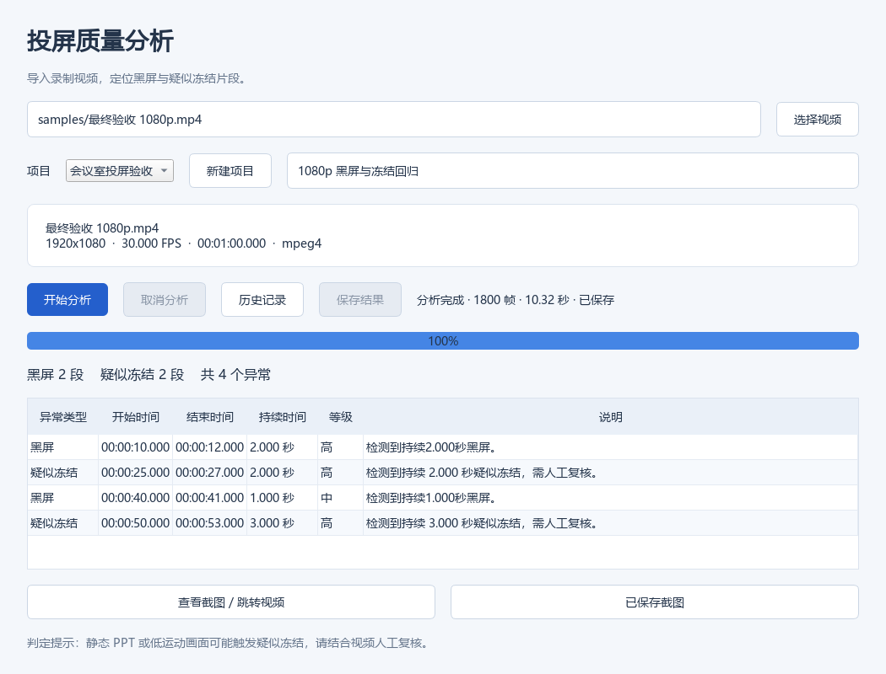
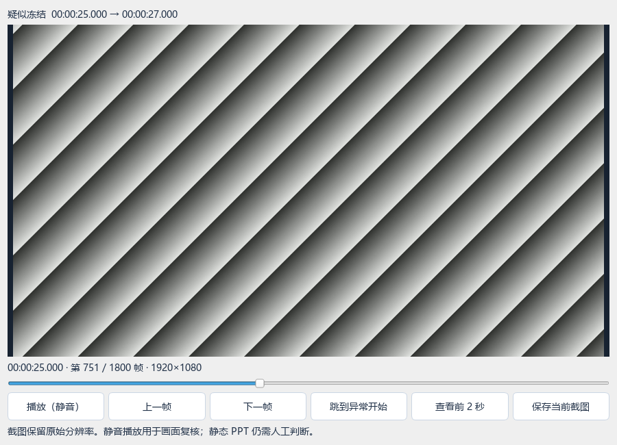
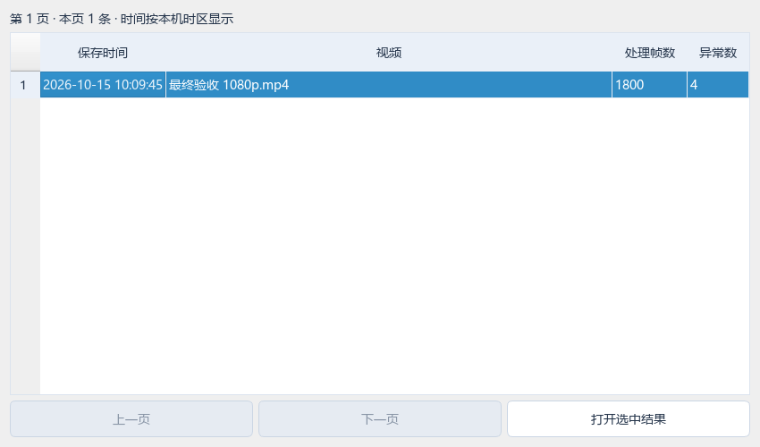
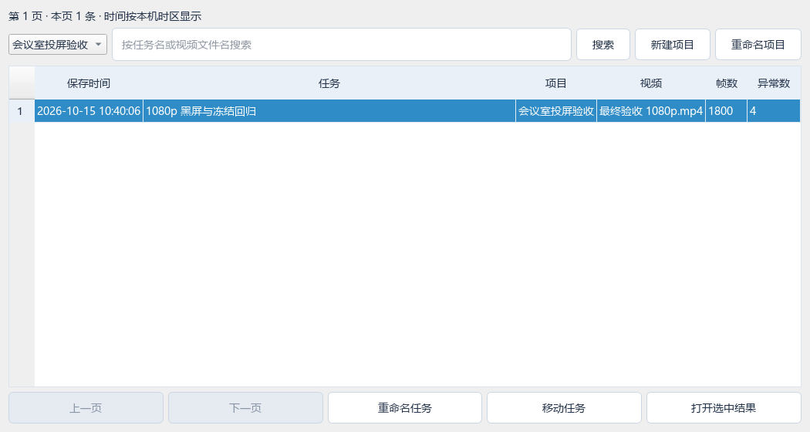
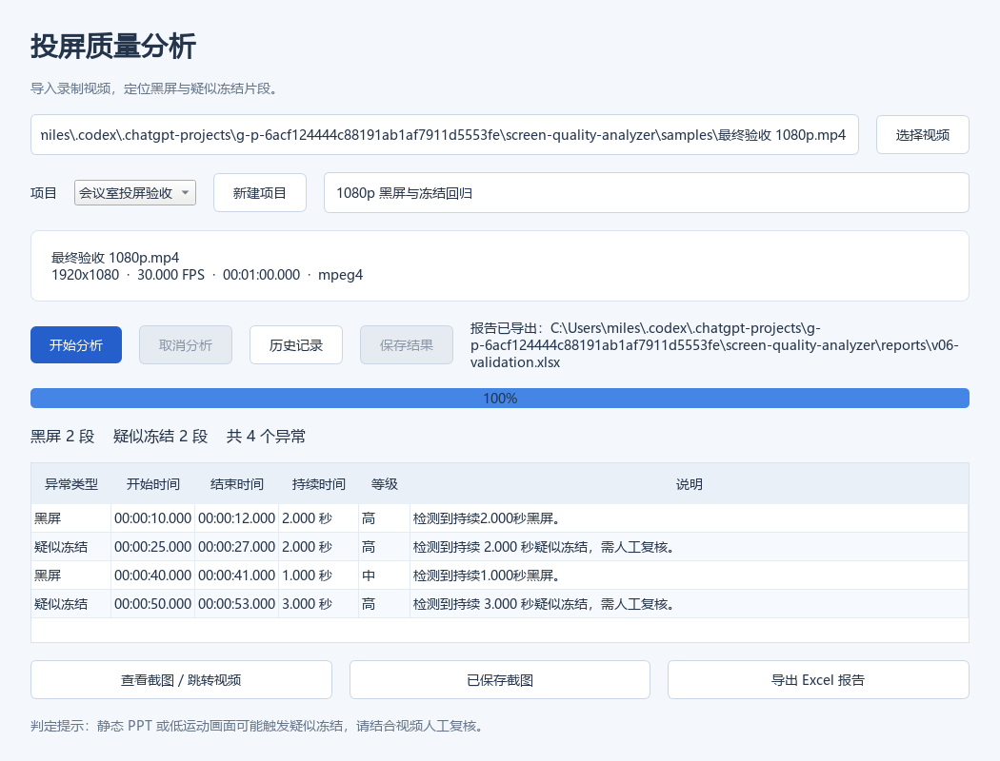
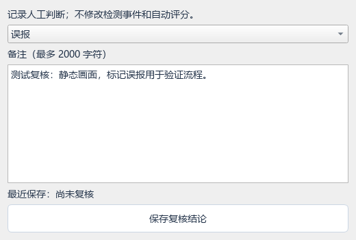

# 智能会议设备投屏质量分析系统 V1.0

面向会议设备投屏测试，对录制的视频进行参数解析、黑屏及疑似冻结分析。当前桌面版为 V0.9.2，V1.0 是后续目标版本。

## 当前进度

|里程碑|能力|状态|
|---|---|---|
|M1|视频 Metadata、视频/音频编码与参数解析|完成|
|M2|VideoReader、黑屏检测、末尾事件与读取异常处理|完成|
|M3|帧差疑似冻结检测、阈值配置、单元测试|完成|
|M4|统一 AnalysisEngine、单视频 CLI、JSON 结果、混合样本验证|完成核心闭环|
|V0.2|PySide6 桌面界面、后台线程、进度、取消及异常列表|已实现，Qt 自动化测试通过|
|V0.3|异常截图、按帧跳转、静音播放、PNG 导出|已实现|
|V0.4|SQLite 历史记录、结果恢复、截图关联和查看|已实现|
|V0.5|项目分组、任务命名/移动、历史筛选与数据库升级|已实现|
|V0.6|Excel 报告、截图链接校验、后台导出与取消、CLI 导出|已实现|
|V0.7|可解释辅助评分、重叠去重、界面/CLI/报告统一展示|已实现|
|V0.8|人工复核状态、备注、筛选、历史保存与报告明细|已实现|
|V0.9|Windows GUI/CLI 便携包、运行路径适配与打包回归|本机验证完成，独立干净 Windows 验收待补充|

## Windows V0.9.2 便携版

构建后解压 `dist/ScreenQualityAnalyzer-V0.9.2-Windows-x64.zip`，保留整个目录并双击 `ScreenQualityAnalyzer.exe`，不需要另装 Python。命令行入口为 `ScreenQualityAnalyzer-CLI.exe`，参数与源码 CLI 相同，输出统一使用 UTF-8。不要只复制 exe，必须保留 `_internal`。

V0.9.1 已内置 `tools/ffprobe.exe`（5.1.2 静态版），解压即可使用，无需安装 FFmpeg 或修改 PATH。请保留 tools 文件夹。已有 `SQA_FFPROBE` 环境变量仍优先；若其路径失效，清除该变量可恢复使用内置版本。程序随后才会回退到系统 PATH。源码运行及样本生成仍按下方安装说明配置。

内置组件保持原样，原发行说明、GPLv3 许可证、对应 FFmpeg 源码地址、版本和哈希随包放在 `licenses/FFprobe`；出处见 [发行方](https://www.gyan.dev/ffmpeg/builds/)。当前包用于本地验收，正式对外分发前仍需核对对应源码及依赖源码提供方式，不能将单个源码链接视为完整分发材料。

打包版默认数据库位于 `%LOCALAPPDATA%/ScreenQualityAnalyzer/analysis.sqlite3`，源码版仍使用项目 `data/analysis.sqlite3`。迁移旧历史需先备份，关闭程序后复制数据库，或启动时用 `--database "旧数据库完整路径"`。视频及截图不自动搬迁。V0.8→V0.9 不改变数据库结构版本 3。

开发者构建（Windows x64）：

```powershell
.venv\Scripts\python -m pip install -r requirements-build.txt
.venv\Scripts\python tools/build_windows.py --ffmpeg-dir "D:/Software/ffmpeg-5.1.2-essentials_build"
.venv\Scripts\python tools/validate_windows.py --package dist/ScreenQualityAnalyzer --video "samples/最终验收 1080p.mp4" --output "reports/打包验证"
```

构建输出 ZIP、SHA-256 校验文件、组件版本和已安装组件的许可证文件。构建依赖快照见 `docs/build-environment-v09.txt`；没有安装器、代码签名和自动更新。本机隔离 PATH 的验证不能替代独立 Windows 电脑验收。

## 安装和运行

要求 Python 3.11+，另行安装 FFmpeg/FFprobe 并加入 PATH。

```powershell
python -m venv .venv
.venv\Scripts\python -m pip install -r requirements.txt
ffmpeg -version
ffprobe -version
.venv\Scripts\python main.py "samples/test.mp4"
.venv\Scripts\python main.py "samples/test.mp4" --json
.venv\Scripts\python main.py "samples/test.mp4" --black-threshold 10 --black-duration 0.5 --freeze-pixel-threshold 5 --freeze-change-ratio 0.01 --freeze-duration 0.5
.venv\Scripts\python black_test.py "samples/test.mp4"
```

CLI 输出 Metadata、BlackScreen/Freeze 数量、按时间排序的事件、处理帧数、耗时及分析速度。`--json` 输出 `video_metadata`、`issues`、`statistics`、`processing_time`、`processed_frames` 和 `analyzed_duration`。退出码 0 表示分析成功（即使检测到异常），1 表示分析失败，2 表示命令行参数错误。错误写入 stderr。

程序接口：

```python
from core.analysis_engine import AnalysisEngine
from core.models import AnalysisConfig

result = AnalysisEngine(AnalysisConfig(freeze_duration=1.0)).analyze("samples/test.mp4")
print(result.statistics)
```

每次分析创建独立检测器，引擎可重复使用；视频逐帧处理，不将整个视频载入内存。使用 `with VideoReader(...)` 可保证异常或提前退出时释放文件。读取帧数低于 OpenCV 报告帧数时默认报错；V0.9.2 对极小末尾偏差增加独立 FFprobe 解码核验，只有计数一致且无解码错误才允许完成，并显示帧数提示。

## 桌面版 V0.9.2

```powershell
.venv\Scripts\python -m pip install -r requirements-gui.txt
.venv\Scripts\python gui_main.py
.venv\Scripts\python gui_main.py "samples/test.mp4"
```

选择视频或粘贴路径，然后点击“开始分析”。视频参数会在后台解析后显示；完成后按时间列出黑屏和疑似冻结。分析期间禁止更换文件或重复启动，点击“取消分析”会丢弃本次未完成结果。更换文件会清空上一份结果。

窗口关闭时自动请求取消，等待后台线程退出后关闭。取消是协作式的：FFprobe 解析（最长 30 秒）或当前帧读取结束后响应；不会强制终止解码线程。帧数未知时显示不定进度，成功结束才显示 100%。

GUI 依赖独立保存在 `requirements-gui.txt`；只使用 CLI 时不需要安装 PySide6。



### 异常截图与视频跳转

1. 分析完成后，双击异常行，或选中行点击“查看截图 / 跳转视频”。未选中时默认打开第一条异常。
2. 复核窗口自动定位至异常开始帧，可拖动帧位置滑块、逐帧查看，或点击“查看前 2 秒”观察异常前后的变化。
3. 点击“播放（静音）”连续查看；暂停并等待读取完成后，点击“保存当前截图”选择 PNG 文件位置。截图保留原分辨率，不包含界面文字。
4. “跳到异常开始”可随时返回起始位置。关闭复核窗口或按 Esc 会先释放后台解码资源；关闭主窗口也会关闭复核任务。

复核使用独立 OpenCV 解码线程，不更改分析结果。连续跳转只保留最新请求；正在读取或播放时禁止导出，避免将旧画面误存为目标截图。视频移动/删除或无法解码时显示错误，不影响已有异常列表。



当前采用 CFR 帧序号定位，索引从 0 开始、界面帧号从 1 开始。静音播放按时间推进，解码较慢时可能跳过显示帧；逐帧按钮和截图仍定位到请求帧。此功能用于画面复核，不是完整影音播放器。暂不支持音频、VFR 精确定位、批量截图或人工复核标注。截图关联持久化已在 V0.4 实现。

### V0.4 历史记录与截图关联

桌面分析成功后自动保存完整 Metadata、算法配置、异常列表、处理耗时、帧数和源文件修改时间。失败或取消的分析不创建成功记录。同一视频再次分析会保存为新任务；打开历史记录和重复点击“保存结果”不会复制当前任务。

- 点击“历史记录”，按保存时间倒序浏览，每页 50 条；双击或点击“打开选中结果”恢复结果，无需重新分析。
- 自动保存失败时，当前结果仍保留，可点击“保存结果”重试。数据库错误不会被误报为分析失败。
- 已入库任务的 PNG 截图自动关联到具体异常，记录绝对路径、帧号、时间点和 SHA-256；点击“已保存截图”查看。
- 截图写入成功但数据库关联失败时，明确提示“文件已保存，但历史关联失败”；文件不会被删除。恢复数据库后可再次保存到相同路径以重试关联。
- 源视频缺失或大小/修改时间发生变化时仍显示历史结果，但禁止视频复核。截图缺失或内容被覆盖时会提示，不会悄悄显示为原证据。

默认数据库是**仓库目录下 `data/analysis.sqlite3`**，与启动时的工作目录无关。可通过参数选择其他数据库：

```powershell
.venv\Scripts\python gui_main.py --database "data/my-project.sqlite3"
.venv\Scripts\python main.py "samples/test.mp4" --json --database "data/my-project.sqlite3"
```

CLI 默认不保存；显式传 `--database` 才保存，自定义检测阈值也一并入库，JSON 结果增加 `task_id`。指定数据库但保存失败时返回退出码 1 并写入 stderr。

使用 Python 标准库 sqlite3，无额外依赖。任务与异常在同一事务中保存；数据库结构版本为 3，V0.4–V0.7 的版本 1/2 会在事务内自动升级；不认识的版本/非本项目数据库会拒绝使用，不会覆盖。数据库和业务截图不进入 Git。

数据库只保存路径与数据，不复制视频或截图。备份时先关闭程序，再一并备份数据库、源视频与截图。当前不提供删除记录和重定位文件；项目分类、任务命名和 V0.4 升级已在 V0.5 实现。源文件一致性依据大小与修改时间，不是视频内容完整哈希。



### V0.5 项目与任务管理

1. 主窗口点击“新建项目”，或从项目下拉框选择已有项目；不选择时使用“未分组”。
2. 填写任务名称，留空时使用视频文件名（默认任务名最多取前 120 字符）。开始分析后，项目和名称随本次任务固定，保存失败重试仍沿用原值。
3. “历史记录”中选择“全部项目”、具体项目或“未分组”，输入任务名/视频文件名后点击“搜索”或按回车。搜索是字面子串匹配，`%` 和 `_` 不作为通配符；英文大小写不敏感。
4. 选中任务后可“重命名任务”或“移动任务”。移动到其他项目或未分组不会更改任务 ID、异常、检测配置和截图关联。
5. 选择具体项目后可“重命名项目”。项目名去除首尾空白，1–80 字符；同名项目不能重复（英文字母大小写视为相同）。任务名 1–120 字符，允许不同任务使用相同名称。

更换筛选条件会返回第一页，每页仍为 50 条。项目是数据库中的逻辑分组，不移动磁盘视频/截图。打开历史结果不新增任务；重新执行分析会建立新任务。任务更名和归属调整请在历史窗口操作，主窗口字段用于下一次分析。

V0.4 数据库第一次打开时自动升级：既有任务归入“未分组”，名称沿用原视频文件名，原始结果和截图保持关联。结构升级与版本号更新在同一事务中；失败会整体回滚。升级后不要使用旧版 V0.4 打开该数据库；旧版会拒绝版本 2。需要回退版本时，应在升级前关闭程序并备份数据库。

CLI 保存时也可指定任务名称和已有项目 ID（项目 ID 可从 Python `AnalysisStore.list_projects()` 获取）：

```powershell
.venv\Scripts\python main.py "samples/test.mp4" --database "data/analysis.sqlite3" --task-name "会议室回归"
```

`--project-id` 接受已有项目 ID，需与 `--database` 一起使用；不存在的项目会导致保存失败，数据库不会留下半条任务。



## V0.6 Excel 报告

更新已有环境后，重新安装依赖：

```powershell
.venv\Scripts\python -m pip install -r requirements.txt
```

分析完成或打开历史任务后，点击“导出 Excel 报告”，选择 `.xlsx` 路径。报告在后台生成，可取消；导出失败或取消后仍可查看当前结果。数据库保存失败时也可导出当前分析结果。

报告包含“分析概况”“异常明细”“截图关联”三张表，记录项目、任务名称、视频参数、检测阈值、事件时间、等级及截图信息。历史任务使用导出时读取的任务名称、项目和关联截图快照。截图经过 SHA-256 校验，仅内容一致时提供本地链接；缺失或更改的文件会标明状态。截图不嵌入文件，分享报告时需另行提供图片；换电脑后原本地链接可能不可用。

```powershell
.venv\Scripts\python main.py "samples/test.mp4" --report "reports/result.xlsx"
.venv\Scripts\python main.py "samples/test.mp4" --database "data/analysis.sqlite3" --task-name "会议室回归" --report "reports/result.xlsx" --overwrite-report --json
```

CLI 默认拒绝覆盖已有报告，明确添加 `--overwrite-report` 才允许覆盖；GUI 由保存窗口确认覆盖。报告先完整写入同目录临时文件，再发布到目标路径，导出失败或发布前取消不会破坏原报告。禁止覆盖源视频、数据库和关联截图。非 Windows 环境的无覆盖发布要求目标文件系统支持硬链接。

报告是静态快照，修改单元格不会重新分析或更新汇总。任务名等输入按文本保存，不作为 Excel 公式执行。导出失败时 CLI 返回 1；成功时 JSON 增加 `report_path`。V0.6 当时沿用结构版本 2；当前 V0.8 使用版本 3。



## V0.7 辅助质量评分

桌面分析完成、打开历史结果、CLI 和 Excel 报告均显示评分，无需新增参数。CLI JSON 增加 `quality`，包含分数、规则版本、有效时长、黑屏/冻结计分时长、分别扣分和不可评分原因。

当前规则 `duration-v1`：

`分数 = 100 × (1 − (黑屏并集秒数 + 0.5 × 非黑屏疑似冻结并集秒数) / 实际分析秒数)`

分数限制在 0–100，最终保留两位小数。同类区间合并，黑屏与冻结重叠部分只按黑屏计算；区间裁剪到实际分析时长，不使用容器时长或事件中冗余的 duration 字段。零时长、无已处理帧、非法时间或未知事件类型显示“不可评分”，不默认为满分。只统计检测器输出的事件，低于检测阈值的片段不计分。

界面展示两类扣分，鼠标悬停汇总可看完整规则。Excel 分析概况追加规则与扣分明细。历史结果按当前规则重新计算，数据库结构不变，旧报告不会修改。后续调整算法须更新规则版本；不同规则或检测阈值的分数不宜直接比较。

这是一项项目自定义的辅助指标，不是行业标准、准确率或设备合格结论；静态 PPT 可能触发疑似冻结。没有检测到异常得 100 分，不代表视频各方面均无问题。尚未测量延迟、音画同步或清晰度，也尚未纳入人工复核结论。

60 秒回归样本黑屏共 3 秒、疑似冻结共 5 秒，扣分分别为 5 和 4.1667，最终 **90.83 分**。

## V0.8 人工复核

1. 分析并保存任务，或打开历史任务。未保存的结果须先点击“保存结果”，再记录复核结论。
2. 选中异常，可先用“查看截图 / 跳转视频”检查画面，关闭画面窗口后点击“记录人工复核”。
3. 选择“待复核”“确认异常”或“误报”，填写最多 2000 字符的备注，点击“保存复核结论”。关闭而不保存不会改动数据库；保存失败会保留输入以便重试。
4. 在“全部复核状态”下拉框选择状态筛选。筛选会清除当前选择，请重新选择要操作的异常。
5. 重新打开历史任务可恢复状态和备注；鼠标悬停状态单元格可查看备注及最近保存时间（UTC）。即使源视频缺失，也可依据已有材料记录结论。
6. 导出 Excel 时，分析概况包含三类复核数量，异常明细包含状态、备注及最近保存时间。长备注完整保存在单元格中，可在 Excel 编辑栏查看。

未记录的异常默认“待复核”；可以改回待复核、清空备注。人工结论独立保存，不删除异常、不改变原检测结果或自动评分。重新分析生成新任务，不继承旧任务结论。当前保留每条异常的最新结论，没有复核人账号或修改审计历史；多个窗口编辑同一记录时最后成功保存者覆盖前值。

**数据库升级到结构版本 3。** 首次打开 V0.4–V0.7 数据库时自动在事务内升级，原结果、项目及截图关联保留，旧异常默认待复核；失败整体回滚。升级前请关闭程序并备份数据库。旧版程序不能打开版本 3，回退软件时应使用升级前备份。CLI 仍用于新分析与报告导出；已有任务的人工复核通过桌面版完成。



## 测试与可复现样本

V0.9 完整源码回归：**155 项通过，无跳过，退出码 0**。另验证实际打包的 GUI/CLI、中文路径、JSON、历史复核及 Excel 导出；独立干净系统验收仍待补充。

V0.8 完整回归：**152 项通过，无跳过，退出码 0**。新增复核存储、迁移回滚、锁定、报告、GUI 编辑和筛选验证。

V0.7 完整回归：**143 项通过，无跳过，退出码 0**。新增评分边界测试，并验证 CLI、历史恢复、GUI 和 Excel 的 90.83 分结果一致。

```powershell
.venv\Scripts\python -m pytest -q
.venv\Scripts\python tools/generate_samples.py
.venv\Scripts\python main.py samples/final_validation.mp4
.venv\Scripts\python tools/generate_samples.py "samples/最终验收 1080p.mp4" --width 1920 --height 1080
.venv\Scripts\python main.py "samples/最终验收 1080p.mp4"
```

V0.6 验证（2026-10-15）：完整回归 **128 项通过，无跳过，退出码 0**。新增报告内容、公式文本保护、截图校验、覆盖保护、失败/取消、CLI 与 GUI 导出测试。新增项目/任务管理、旧版数据库迁移和回滚、筛选分页、Qt 操作以及 CLI 归属测试。新增 SQLite 往返恢复、事务回滚、锁定/损坏/版本保护、CLI 持久化、截图关联与历史 GUI 测试。新增真实编码视频的按帧定位、截图像素/分辨率、中文 PNG 路径、跳转竞争、播放暂停/末尾、复核窗口关闭及解码错误测试。新增后台线程分析、取消、关闭、重复分析、错误恢复和 UI 事件循环响应测试。未安装 PySide6 时 GUI 测试会跳过。原 M1–M4 的 61 项测试全部保留。测试包括真实 MP4 编码/解码、720p/1080p、30/29.97 FPS、中文路径、无效文件、0.5 秒边界、视频末尾、多段事件、JSON CLI 和引擎重复使用。缺少 FFmpeg/FFprobe 时部分集成测试会跳过；跳过不代表通过验收。

生成器创建 60 秒、30 FPS 的动态测试图，插入黑屏 10–12 秒及 40–41 秒、冻结 25–27 秒及 50–53 秒，预期仅 4 个事件。视频留在本地，Git 保存生成器和验证记录。测试使用人工合成但经过实际编码的视频，并非真实会议录屏；真实设备素材的泛化验证仍待补充。

## 判定规则与已知边界

- 黑屏：缩放至 320×180，平均灰度严格小于 10，持续至少 0.5 秒。
- 冻结：相邻缩放灰度帧绝对差大于 5 的像素比例严格小于 1%，持续至少 0.5 秒。事件从第一张重复画面开始；黑屏候选切断冻结候选，避免重复告警。
- 严重等级：不足 1 秒 LOW，1 至不足 2 秒 MEDIUM，至少 2 秒 HIGH。
- 事件使用 `[start_time, end_time)`；视频末尾结束时间包含最后一帧的显示时长。
- 时间按 `index / fps` 计算，只保证固定帧率（CFR）素材；变帧率 PTS 尚未支持。OpenCV 不能可靠区分所有损坏视频与 EOF；未知帧数时无法保证识别提前截断，错误帧数也可能导致保守报错；极小末尾偏差可通过独立核验处理。
- 静态 PPT、低运动画面可能被标为疑似冻结；低亮度内容也可能触发黑屏。结果需人工复核，不代表已确认设备故障。
- 缺失 Metadata 帧数时使用时长×帧率估算；容器时长可能含较长音轨，因此事件末尾使用实际解码帧数计算。容器码率回退值包含音频等开销。
- 本版不测量端到端投屏延迟，未承诺真实会议数据上的准确率。

## 目录与后续里程碑

`core/` 保存模型、解析器、读取器、检测器及分析引擎；`tests/` 保存单元/集成测试；`gui/` 保存窗口和后台任务；`storage/` 保存 SQLite 数据访问；`reporting/` 保存 Excel 导出；`tools/` 保存样本生成器与界面渲染验证脚本；`samples/` 保存本地样本；`docs/` 保存开发与验证记录。

V0.2–V0.8 已实现；V0.9 已构建 Windows 便携包并完成本机隔离验证，独立干净 Windows 验收待补充。后续推进：V1.0 发布及软著材料整理。算法方面补充真实会议素材、VFR 时间戳支持及静态内容误报评估。

## 软著用途

保存真实开发代码、版本记录和测试证据，后续说明书与最终发布的软件功能保持一致。当前技术验证版不代表 V1.0 已发布或已取得登记。

V0.2 详细验证与已知限制见 [验证记录](docs/V0.2-validation.md)。

V0.3 验证与使用边界见 [验证记录](docs/V0.3-validation.md)。

V0.4 验证详情见 [验证记录](docs/V0.4-validation.md)。

V0.5 验证详情见 [验证记录](docs/V0.5-validation.md)。

V0.6 验证详情见 [验证记录](docs/V0.6-validation.md)。

V0.7 评分规则与验证见 [验证记录](docs/V0.7-validation.md)。

V0.8 数据迁移与人工复核验证见 [验证记录](docs/V0.8-validation.md)。

V0.9 构建与验证记录见 [验证记录](docs/V0.9-validation.md)。

V0.9.1 内置 FFprobe 验证见 [验证记录](docs/V0.9.1-validation.md)。

## V0.9.2 帧数估算偏差修复

修复“已读取 5637/5639 帧”这类尾部估算偏差导致整个分析失败的问题。近末尾缺帧不超过 `min(10, max(2, ceil(FPS × 0.1)))` 且占比不超过 0.1% 时，使用内置 FFprobe 独立完整解码计数。只有计数与实际已读取帧数一致、进程成功且没有错误输出时才放行；明显截断、核验不一致或错误仍失败。

核验额外读取一次视频，最长 180 秒，可取消；超时不生成成功结果。GUI 会显示核验状态，完成后显示实际帧数与元数据差异；CLI JSON 增加 warnings，Excel 分析概况增加读取提示。历史任务依靠保存的元数据和实际帧数恢复提示，不变更数据库结构。不能据此保证所有损坏视频均能被发现。

具体问题视频与验证记录见 [V0.9.2 验证](docs/V0.9.2-validation.md)。
