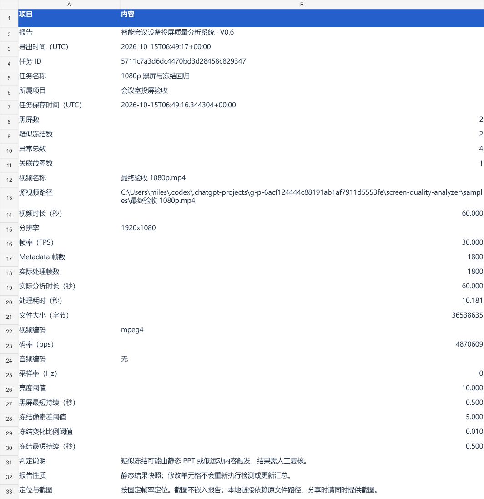
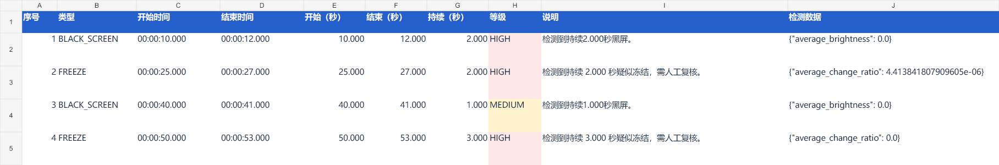
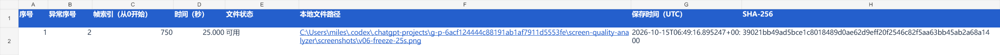

# V0.6 Excel 报告验证

验证日期：2026-10-15。环境：Windows、Python 3.11+、PySide6 6.12.0、openpyxl 3.1.5。

## 自动化验证

- 完整 pytest：128 passed，60.41 秒，无跳过，进程退出码 0。
- Windows 无覆盖发布改为 rename 后，报告及 GUI 导出相关测试再次运行：11 passed，退出码 0。
- 覆盖内容：三张工作表、历史任务快照、空结果、中文路径、公式文本保护、缺失/更改截图、文件覆盖保护、写入失败与取消、CLI JSON、GUI 历史任务导出、保存失败时导出。
- 失败和发布前取消保留已有目标文件，并清理临时文件。

## 实际编码视频闭环

使用生成器创建的 60 秒、1920×1080、30 FPS MP4，实际读取 1800 帧。该样本为合成测试内容，不是现场会议录像。

Qt 离屏执行：分析 → 入库 → 查看第 750 帧并导出截图 → 打开历史 → 导出 XLSX。

报告回读确认：黑屏 10–12 秒、40–41 秒；疑似冻结 25–27 秒、50–53 秒，共 4 条事件；1 条截图关联，状态“可用”且带链接；项目、任务与保存信息一致。

复现：

```powershell
.venv\Scripts\python -m pytest -q
.venv\Scripts\python tools/generate_samples.py "samples/最终验收 1080p.mp4" --width 1920 --height 1080
.venv\Scripts\python tools/render_gui_validation.py "samples/最终验收 1080p.mp4" --database data/v06-validation.sqlite3
```

输出 `reports/v06-validation.xlsx` 留在本地。三张表经只读导入渲染，检查中文、换行、时间和数值、等级底色与链接排版。没有在原生 Excel 中交互验收，也没有自动点击原生文件保存窗口。








## 边界与后续

报告为静态快照，截图以外部本地链接提供；移动文件或换电脑会影响链接。导出过程在后台运行，取消为协作式；最终文件发布成功后视为完成。Windows 无覆盖发布使用 rename，其他平台使用硬链接；不支持硬链接的文件系统会报错并保留原文件。

本次 SQLite 结构版本仍为 2。下一阶段 V0.7 为质量评分，后续推进人工复核、打包回归及发布材料。
