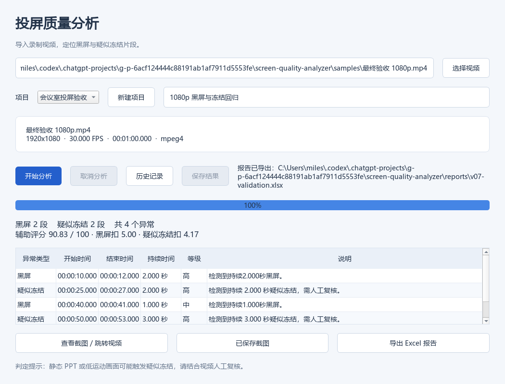
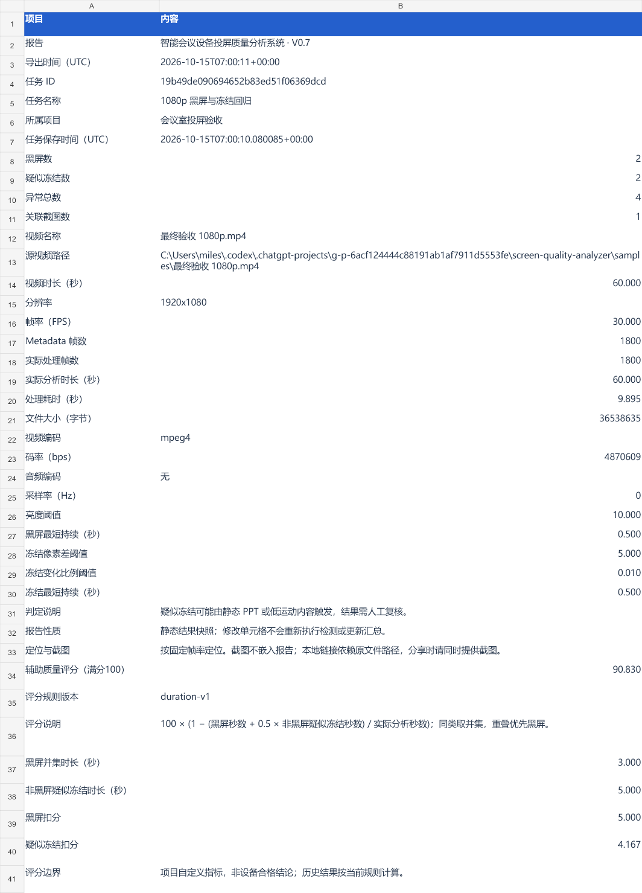

# V0.7 辅助质量评分验证

日期：2026-10-15。

评分规则为项目自定义 `duration-v1`，不是行业标准或设备合格判定。黑屏占比权重 1，疑似冻结占比权重 0.5；区间并集去重，重叠优先黑屏，分母为实际分析时长。分数最终四舍五入到两位小数。原始扣分保留精度，因此显示的两个两位小数扣分相加可能存在舍入差异。

## 验证结果

- 完整回归 143 passed，64.68 秒，无跳过，退出码 0。
- 新增 15 个用例覆盖无异常、全黑屏、全冻结、混合事件、乱序/重复/重叠、越界裁剪、零长度事件、无效时长和时间、未知类型、无帧和历史恢复。
- 既有 Excel 与 GUI 用例增加评分一致性断言。
- 实际编码样本：60 秒、1080p、30 FPS、1800 帧。黑屏 3 秒、疑似冻结 5 秒，得分 90.83；CLI JSON、Qt 历史恢复及 XLSX 回读一致。
- Qt 离屏渲染检查评分与扣分展示；Excel 使用只读导入渲染检查追加字段。未进行原生 Excel 交互测试。

复现：

```powershell
.venv\Scripts\python -m pytest -q
.venv\Scripts\python main.py "samples/最终验收 1080p.mp4" --json
.venv\Scripts\python tools/render_gui_validation.py "samples/最终验收 1080p.mp4" --database data/v07-validation.sqlite3
```





## 数据兼容与边界

评分是 AnalysisResult 的派生属性，不改变 SQLite 结构或原检测事件；历史结果按当前规则计算。JSON 新增 quality 字段，Excel 追加评分字段，旧报告保持不变。算法变更必须更新规则版本。

合成素材验证不代表真实会议准确率。静态 PPT 可能触发冻结；检测阈值以下事件不扣分。评分未考虑延迟、清晰度、音画同步和人工确认。下一阶段 V0.8 增加人工复核状态与备注。
