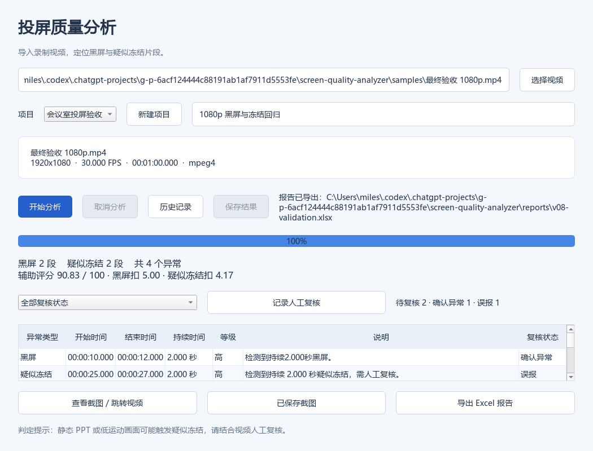
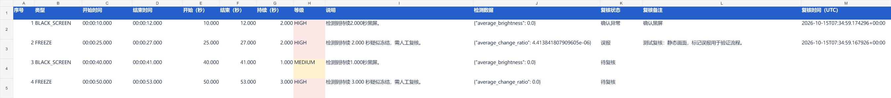

# V0.8 人工复核验证

验证日期：2026-10-15。

## 实现范围

每个任务的异常按原始序号关联独立复核记录，支持待复核、确认异常、误报以及最多 2000 字符的备注。未记录即待复核；最近保存时间使用 UTC。当前只保留最新结论，不提供账号身份与修改审计。

主窗口支持状态筛选、复核汇总和编辑入口。筛选隐藏行但不改变原始异常序号，避免将复核或截图关联到错误异常。源视频不可用时仍可编辑结论；未入库任务需先保存。保存失败保留对话框输入。

Excel 追加复核状态、备注、时间及三类数量。导出读取同一数据库事务中的任务、截图与复核快照。原始事件与自动评分不随人工结论变化。

## 验证结果

- 全量 pytest：152 passed，60.59 秒，无跳过，退出码 0。
- 新增 9 个用例：状态往返和清空、评分/检测数据不变、报告文本与时间、非法状态/序号/备注、迁移失败回滚、数据库锁定、GUI 保存失败重试、历史恢复、筛选与定位。
- 既有版本 1 迁移测试更新为验证顺序升级到版本 3。
- 实际编码视频：60 秒、1920×1080、30 FPS、1800 帧。检测 2 段黑屏、2 段疑似冻结；测试中人工标记 1 条确认、1 条误报，剩余 2 条待复核。
- 打开历史后，状态与备注保持一致；XLSX 回读三类数量、备注、时间与截图关联正确，自动评分仍为 90.83。
- Qt 离屏截图验证主窗口和编辑框；报告只读渲染检查复核列。未进行原生 Excel 和原生文件对话框交互验收。

复现：

```powershell
.venv\Scripts\python -m pytest -q
.venv\Scripts\python tools/render_gui_validation.py "samples/最终验收 1080p.mp4" --database data/v08-validation.sqlite3
```

样本为合成编码视频，复核标记用于验证流程，不是对真实设备作出的判定。






## 数据升级与限制

SQLite 从版本 2 升级到 3，新增 reviews 表，包含状态约束、备注长度约束及任务/异常外键。迁移与版本号更新在同一事务内完成，失败整体回滚；旧任务无复核行时默认待复核，原始数据保持不变。

升级前关闭程序并备份数据库；旧程序拒绝版本 3，不能直接降级使用。同条记录由最后成功保存的窗口覆盖，无冲突合并。Excel 长备注完整保存，可在编辑栏查看，固定行高预览不保证展开全部 2000 字符。

下一阶段为 V0.9 打包与回归。
