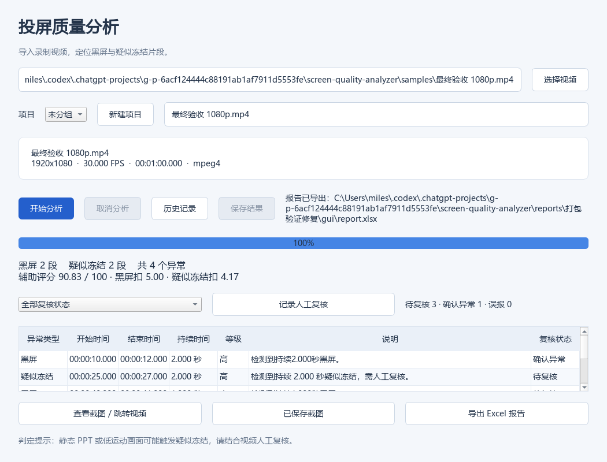

# V0.9 Windows 打包验证

验证日期：2026-10-16。当前完成可执行程序构建与本机隔离验证；独立干净 Windows 机器验收尚未完成。

## 构建产物

- `dist/ScreenQualityAnalyzer-V0.9-Windows-x64.zip`，103,769,268 字节（约 99 MiB）。
- SHA-256：`2eeebea2dede484723c46062b093189a309fedb071d1b45d3c9b7b48e19909c6`。
- GUI：`ScreenQualityAnalyzer.exe`；CLI：`ScreenQualityAnalyzer-CLI.exe`；必须保留 `_internal`。
- 附中文说明、依赖版本及已安装第三方包提供的许可证文件；不捆绑 FFprobe。
- 构建环境：Windows x64（系统构建 26200）、Python 3.11.2、PyInstaller 6.22.3；具体依赖见 [版本快照](build-environment-v09.txt)。

构建遵循 [PyInstaller 分发与 spec 文档](https://www.pyinstaller.org/en/stable/spec-files.html)，冻结运行路径参考 [运行时文档](https://pyinstaller.org/en/stable/runtime-information.html)。

## 验证结果

- 全量源码回归：155 passed，68.07 秒，无跳过，退出码 0。
- 打包后的进程 PATH 仅保留 Windows System32，移除 Python/虚拟环境路径变量；FFprobe 使用明确的外部路径。
- 缺少 FFprobe 时 CLI 返回 1，并输出可识别的配置错误。
- 实际分析中文路径 60 秒 1080p/30 FPS 合成视频：1800 帧、2 段黑屏、2 段疑似冻结、90.83 分。
- 打包 CLI 的 UTF-8 JSON、SQLite 保存和 XLSX 导出通过。
- 打包 GUI 的 Qt 离屏自检：后台分析、保存、人工确认一条异常、历史恢复、Excel 导出、报告回读和界面截图通过。
- 最终 ZIP 解压到中文目录后再次执行相同验证，检查运行不依赖原 dist 目录及当前工作目录。



## 打包中修复的问题

1. Windows 本地代码页使重定向中文 JSON 无法以 UTF-8 读取：分发 CLI 显式设定 stdout/stderr 编码。
2. 开发环境 PATH 中 Poppler 的同名 ICU DLL 被错误收集，导致 QtCore 加载失败：构建脚本隔离 PATH 并清空构建缓存，避免外部软件污染依赖。
3. 冻结程序不能默认向安装资源目录写数据库：改用 `%LOCALAPPDATA%/ScreenQualityAnalyzer/analysis.sqlite3`；源码行为保持不变。

## 重现

```powershell
.venv\Scripts\python -m pip install -r requirements-build.txt
.venv\Scripts\python tools/build_windows.py
.venv\Scripts\python tools/validate_windows.py --package dist/ScreenQualityAnalyzer --video "samples/最终验收 1080p.mp4" --ffprobe "C:/ffmpeg/bin/ffprobe.exe" --output "reports/打包验证"
```

本地 ZIP 和生成的测试数据库、报告不提交 Git；代码、构建脚本与验证记录提交 GitHub。重新构建的二进制哈希可能变化，应核对同次构建生成的 `.sha256` 文件。

## 尚待验收

当前机器已有开发依赖，隔离 PATH 不是干净系统验证。正式发布前仍需在独立 Windows x64 电脑验证：首次启动、FFprobe 配置、原生文件对话框、异常截图与播放、旧数据库迁移、取消与关闭，以及原生 Excel 打开报告。本次没有新增打包后二进制的截图播放回归；对应源码测试仍通过。

此版无安装器、代码签名或自动更新；未发布正式 GitHub Release。V0.8 到 V0.9 保持数据库结构版本 3。完成独立机器验收后再进入 V1.0 发布与软著材料整理。
